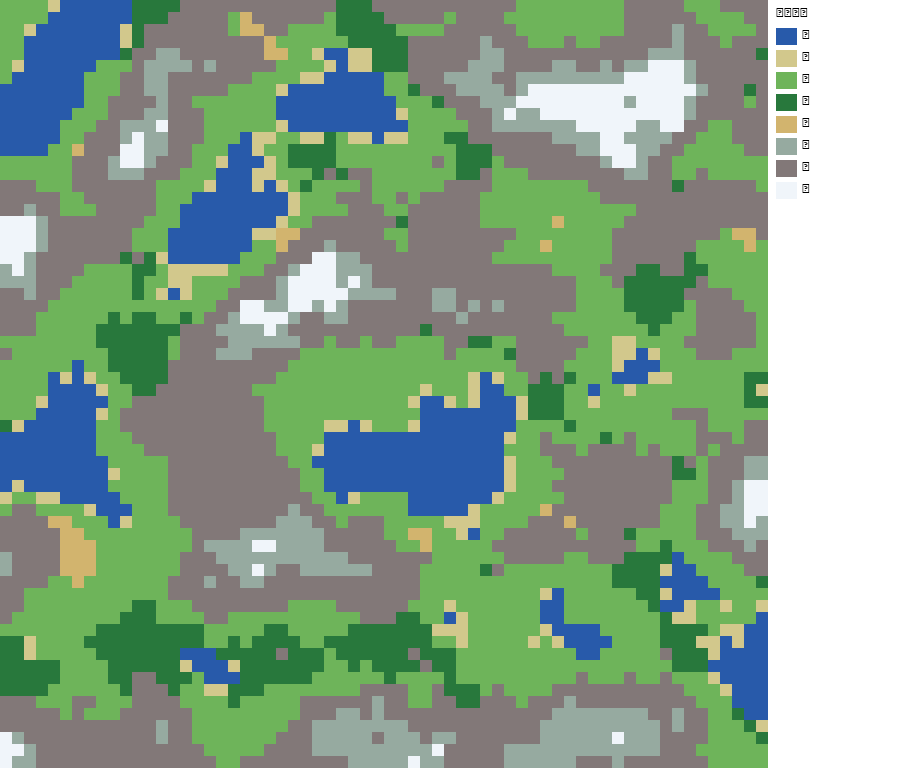
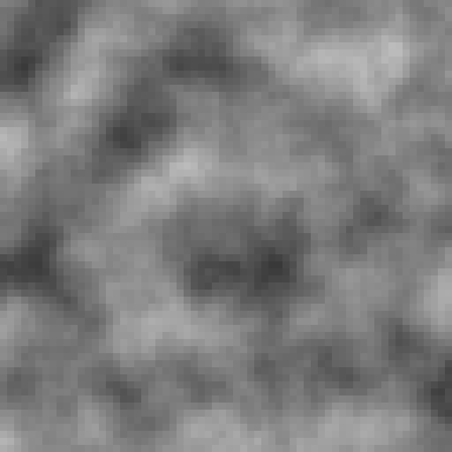
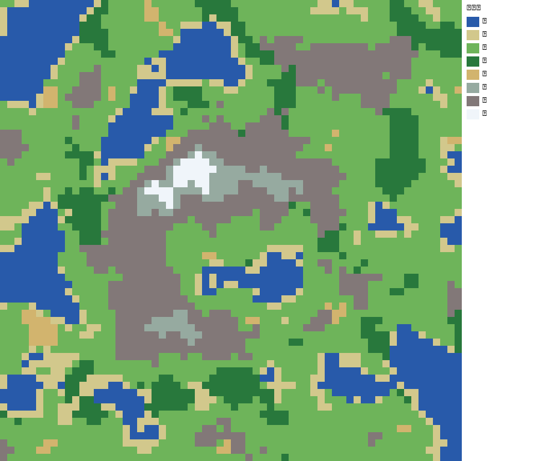
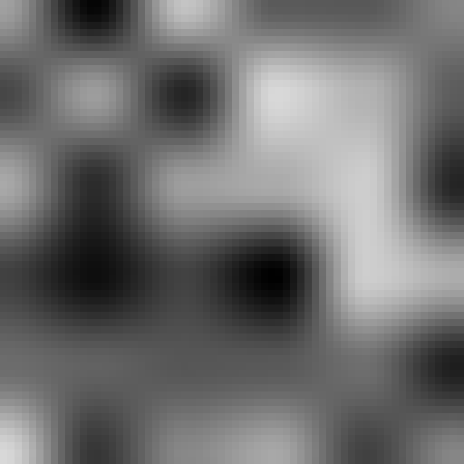
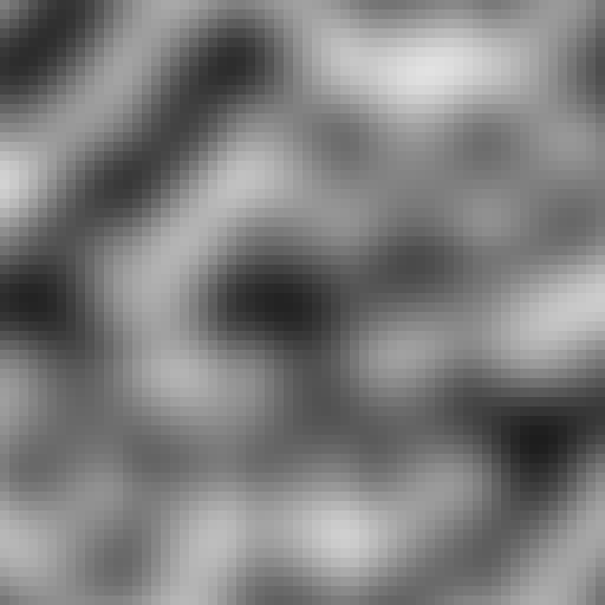
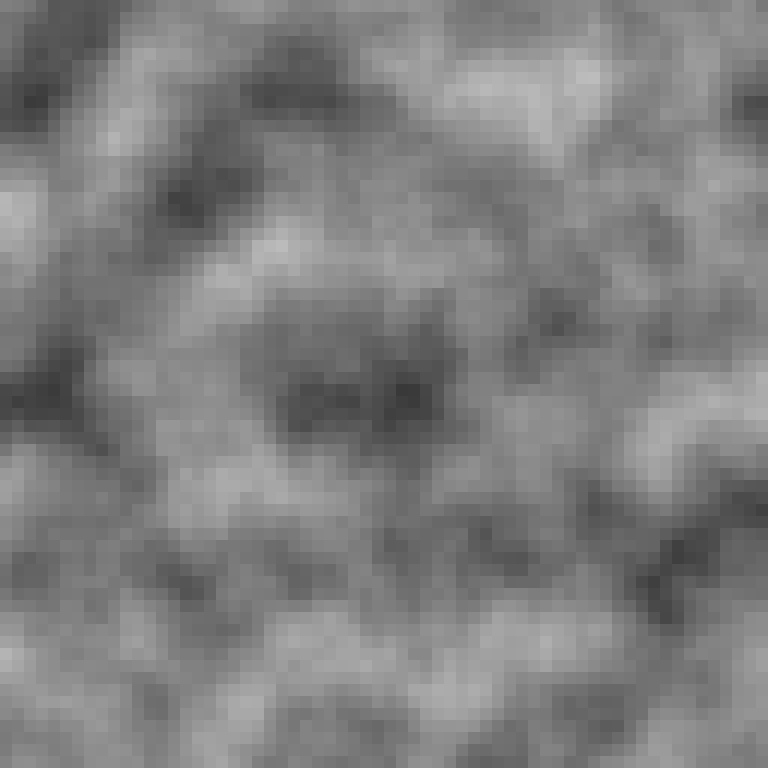
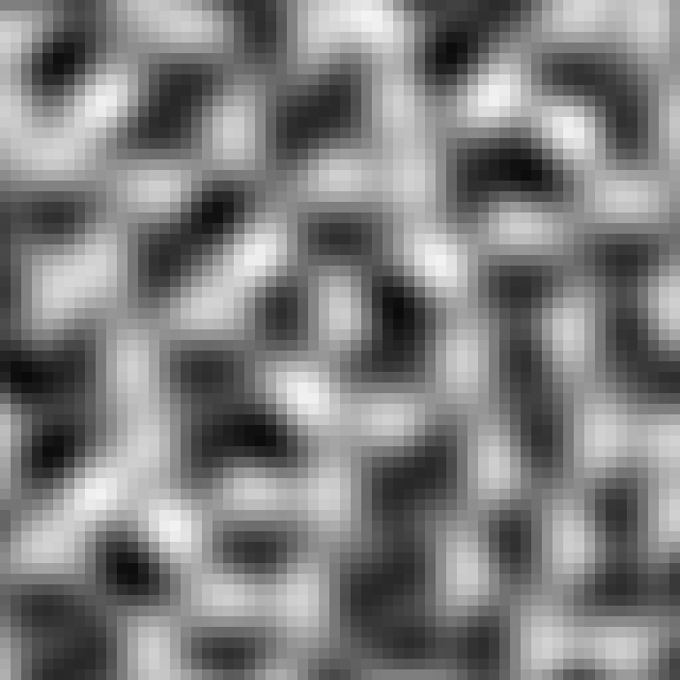
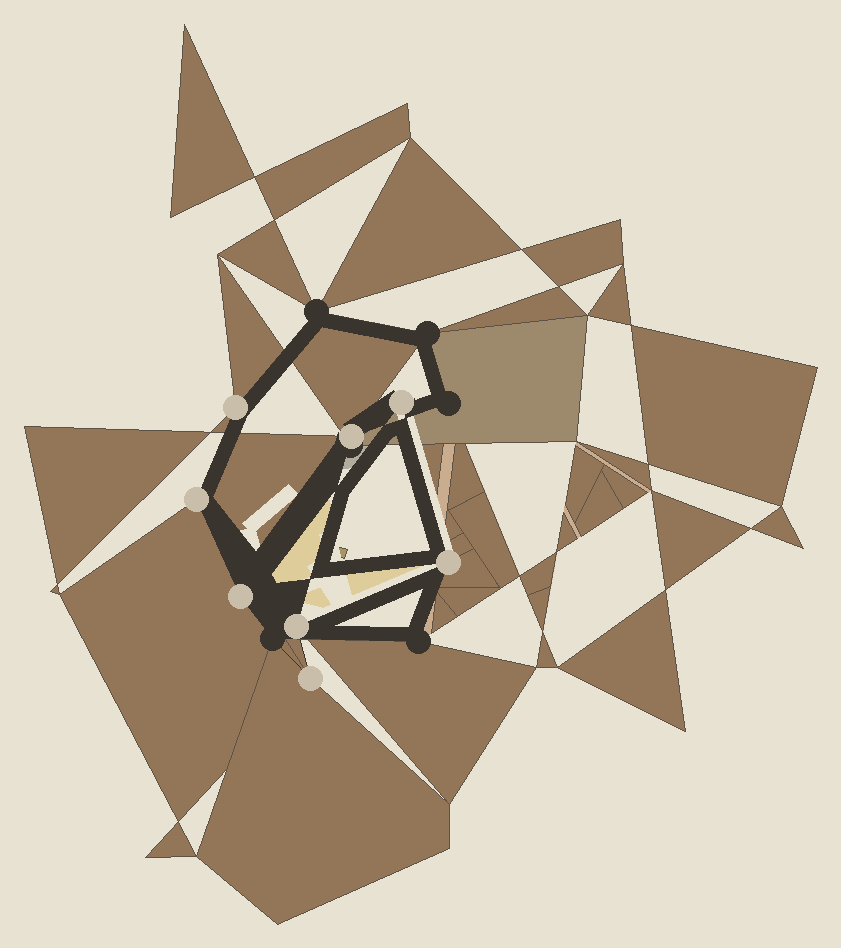

# 冒险者公会任务包（worldbuilder 实操成果）

- 种子 seed = 7
- 生成时间由运行环境决定；输出目录：<PATH>\example\output

## 1. 世界与生物群系 (generate_world)

| 群系 | 格数 |
| --- | --- |
| 水 | 450 |
| 滩 | 128 |
| 草 | 1343 |
| 林 | 322 |
| 漠 | 34 |
| 苔 | 307 |
| 山 | 1390 |
| 雪 | 122 |

  

岛屿版（falloff=0.35，演示径向衰减成岛）：

## 2. 地牢 (generate_dungeon / generate_dungeon_bsp)

- 随机房间式：9 房间 / 8 连接
- BSP 式：8 房间 / 7 连接

  

## 3. 洞穴 (generate_cave, 元胞自动机)

- 连通块数：2，最大可走地板格数：1140

## 4. 噪声对比 (value / perlin / fbm / simplex)

 
 

## 5. 名字生成 (NameGenerator, 音节 / 马尔可夫)

### fantasy
- 音节拼接：Edradil、Thoaethoaedil、Galisunwen、Drafendil、Fenavyn、Galthoomrion、Draaundil、Voraisundor
- 马尔可夫：Elen、Isolden、Thorian、Galena、Zyra、Vorian、Isolden、Wreya

### sci
- 音节拼接：Qzyx、Bloblixon、Aroaranyx、Tnyx、Nxix、Tblanon、Zxinoid、Arexzinyx
- 马尔可夫：Quill、Atlas、Zenith、Cyber、Cyber、Pulsar、Blipher、Quill

### eastern
- 音节拼接：白玄辰、顾月顾雪轩、苏月苏川辰、凌墨辰、墨长瑶、凌顾川轩、玄长霄霜、苏云玄霄辰
- 马尔可夫：Moyu、Shuang、Hangyunxi、Guchangyun、Ling、Chengyu、Suyue、Yunxi

## 6. 掉落表 (LootTable)

- 普通宝箱（5 抽）：金币 x8、药水、金币 x10、金币 x9、符文
- 限定掉落（不重复 3 抽）：金币 x8、药水 x3、宝石

## 7. 城镇 (generate_town)

- 区划数：15，带城墙：True，城门：11，街道：9，建筑：26

| ward 类型 | 数量 |
| --- | --- |
| Craftsmen | 12 |
| Market | 1 |
| Cathedral | 1 |
| Merchant | 1 |

> 说明：`generate_town` 从零移植自 watabou 的 Medieval Fantasy City Generator（Haxe/OpenFL），复刻其 Voronoi 划区 + Lloyd 松弛、城墙（塔楼/城门）、图寻路路网、ward 加权分配与建筑递归分割等核心算法，以纯 Python + numpy 实现，无外部图形依赖。

## 附：实操观察

- `classify_biomes` 中 TUNDRA（苔原）分支存在逻辑冲突：它要求 `temperature<0.25`（即 `hm>0.75`），但同一条语句又被限定在 `low = hm<0.75` 的集合内，导致苔原在默认参数下永远无法出现（本包中苔原格数恒为 0）。这是 worldbuilder 库的一个待修复点。
- 生物群系图对高度图做了 min-max 归一化拉伸，否则 fBm 输出罕见 >=0.75，山/雪几乎不出现；这是程序化地形常见的对比度预处理。
